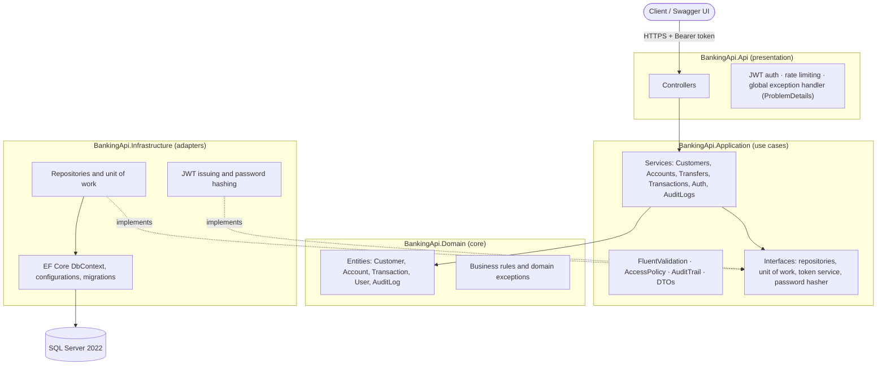
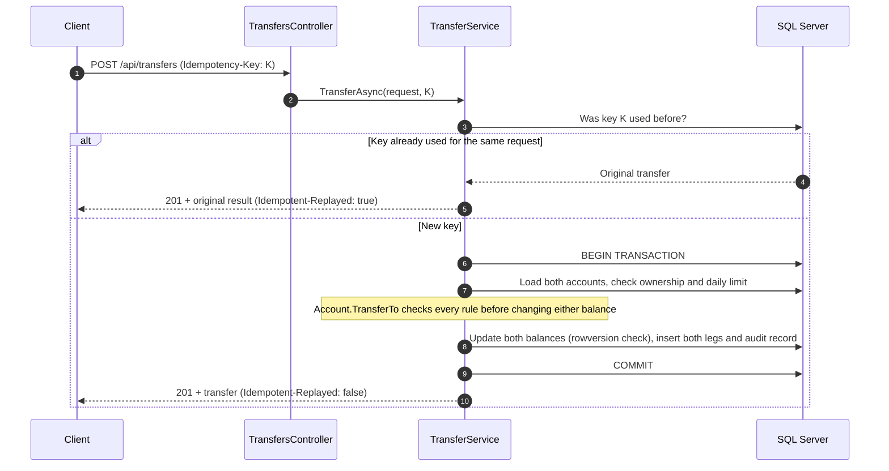

# Banking Transactions REST API

[](https://github.com/Shashika2001/Banking-Transactions-REST-API/actions/workflows/ci.yml)


A banking backend built with ASP.NET Core 8 and Clean Architecture. Customers register, open accounts, deposit,
withdraw and transfer money. Admins oversee everything through an audit log.

The project focuses on the problems that make money-moving APIs hard. A retried request must never move money
twice. A transfer must update both accounts or neither. Two concurrent requests must not overspend a balance. A
customer must never see someone else's account.

## Contents

- [Features](#features)
- [Architecture](#architecture)
- [Tech stack](#tech-stack)
- [Running with Docker](#running-with-docker)
- [API endpoints](#api-endpoints)
- [Design decisions](#design-decisions)
- [Testing approach](#testing-approach)
- [Running without Docker](#running-without-docker)
- [Configuration](#configuration)
- [Limitations and next steps](#limitations-and-next-steps)
- [AI-assisted development](#ai-assisted-development)

## Features

- **Accounts and money movement:** open accounts, deposit, withdraw, check balances and page through
  transaction history with a date-range filter.
- **Transfers between accounts:**
  - **Atomic:** both sides of a transfer commit in a single database transaction, or neither does.
  - **Idempotent:** a required `Idempotency-Key` header means a retried request returns the original result
    instead of moving money again.
  - **Limited:** each account has a configurable daily transfer limit.
- **Business rules in the domain model:** no zero or negative amounts, at most two decimal places, no overdrafts,
  no activity on frozen or closed accounts, and no transfers between different currencies.
- **Optimistic concurrency:** a SQL Server `rowversion` column on every account detects lost updates.
- **Authentication and authorization:**
  - **JWT bearer tokens** with `Customer` and `Admin` roles.
  - **Ownership checks:** customers can only reach their own data.
  - **Password hashing:** PBKDF2 through ASP.NET Core Identity's `PasswordHasher`.
  - **Rate limiting:** login attempts are limited per client IP.
- **Audit trail:** every financial operation writes an audit record in the same transaction as the operation
  itself. Admins can search the log.
- **Consistent errors:** every error is an RFC 7807 `ProblemDetails` response with a machine-readable
  `errorCode` and a `traceId`. Stack traces are never leaked.
- **Privacy:** national IDs are masked in every response (only the last 4 characters are shown).
- **Production basics:** validated configuration, secrets kept out of source control, a `/health` endpoint that
  checks the database, Swagger UI with bearer-token support, and a multi-stage Docker image that runs as a non-root
  user.

## Architecture

The solution follows Clean Architecture. Dependencies point inward, and an architecture test fails the build if a
layer takes on a dependency it shouldn't.



| Project | Responsibility | Depends on |
| --- | --- | --- |
| `BankingApi.Domain` | Entities, enums, business rules, domain exceptions | Nothing |
| `BankingApi.Application` | Use-case services, DTOs, validators, authorization policy, interfaces for persistence and security | Domain |
| `BankingApi.Infrastructure` | EF Core and SQL Server, repositories, unit of work, JWT, password hashing | Application, Domain |
| `BankingApi.Api` | Controllers, authentication, rate limiting, exception handling, Swagger, startup | Application, Infrastructure |
| `BankingApi.UnitTests` | xUnit tests for every layer | All of the above |

This is how a transfer flows through the layers:



## Tech stack

| Area | Technology |
| --- | --- |
| Runtime and language | .NET 8, C# 12, nullable reference types, warnings treated as errors |
| Web | ASP.NET Core 8 Web API (controllers), built-in rate limiting, `ProblemDetails` |
| Data | Entity Framework Core 8, SQL Server 2022, code-first migrations |
| Security | JWT bearer authentication, ASP.NET Core Identity `PasswordHasher` (PBKDF2) |
| Validation | FluentValidation 12 |
| API documentation | Swashbuckle (Swagger UI) with XML comments and bearer-token support |
| Testing | xUnit, Moq, FluentAssertions 7, coverlet code coverage |
| Delivery | Docker (multi-stage build), Docker Compose, GitHub Actions |

## Running with Docker

You need Docker with Compose v2. Nothing else is required; the .NET SDK is only needed for local development.

```bash
git clone https://github.com/Shashika2001/Banking-Transactions-REST-API.git
cd Banking-Transactions-REST-API

cp .env.example .env        # local-only passwords and keys; edit them if you like
docker compose up --build
```

When the logs show `Now listening on: http://[::]:8080`:

- Swagger UI: <http://localhost:8080/swagger>
- Health check: <http://localhost:8080/health>

On startup in Development, the API applies the EF Core migrations, creates the admin account, and seeds demo data.
The passwords come from your `.env` file:

| User | Email | Password (`.env`) | Seeded data |
| --- | --- | --- | --- |
| Admin | `admin@example.com` | `ADMIN_PASSWORD` | Full access, including audit logs |
| Customer | `jane.doe@example.com` | `DEMO_USER_PASSWORD` | Two USD accounts |
| Customer | `john.smith@example.com` | `DEMO_USER_PASSWORD` | One USD account, one EUR account |

The seed data also includes one transfer from Jane to John, so transaction history isn't empty.

**Try it.** Sign in through `POST /api/auth/login` in Swagger. Click **Authorize** and paste the `accessToken`,
then call `GET /api/customers/{customerId}` with the `customerId` from the login response. To try a transfer:

```bash
curl -X POST http://localhost:8080/api/transfers \
  -H "Authorization: Bearer <accessToken>" \
  -H "Content-Type: application/json" \
  -H "Idempotency-Key: $(uuidgen)" \
  -d '{"sourceAccountId":"<your account id>","destinationAccountId":"<other account id>","amount":25.00,"reference":"Test"}'
```

Send the same request again with the same `Idempotency-Key`. You get the original response back with
`Idempotent-Replayed: true`, and no money moves.

To stop the stack, run `docker compose down`. Add `-v` to delete the database volume as well.

## API endpoints

Every endpoint requires a bearer token unless it's marked **Anonymous**. "Owner" means the customer the account or
record belongs to. Admins can do everything an owner can.

| Method | Route | Access | Description |
| --- | --- | --- | --- |
| `POST` | `/api/auth/register` | Anonymous | Register as a customer; returns a token |
| `POST` | `/api/auth/login` | Anonymous, rate limited | Sign in; returns a token |
| `POST` | `/api/customers` | Admin | Create a customer |
| `GET` | `/api/customers` | Admin | List customers (paginated) |
| `GET` | `/api/customers/{customerId}` | Owner | Get a customer (national ID masked) |
| `POST` | `/api/accounts` | Owner | Open an account |
| `GET` | `/api/accounts/{accountId}` | Owner | Get an account |
| `GET` | `/api/accounts/{accountId}/balance` | Owner | Get the current balance |
| `POST` | `/api/accounts/{accountId}/deposits` | Owner | Deposit money |
| `POST` | `/api/accounts/{accountId}/withdrawals` | Owner | Withdraw money |
| `POST` | `/api/transfers` | Owner of the source account | Transfer money; requires an `Idempotency-Key` header |
| `GET` | `/api/accounts/{accountId}/transactions` | Owner | Transaction history: `pageNumber`, `pageSize`, `from` (inclusive), `to` (exclusive) |
| `GET` | `/api/audit-logs` | Admin | Search the audit log by user, action, entity and time range |
| `GET` | `/health` | Anonymous | Liveness and database check |

**Errors** are RFC 7807 `ProblemDetails` responses with a `traceId`:

| Status | When | Example `errorCode` |
| --- | --- | --- |
| 400 | Validation failed; the response includes per-field `errors` | `Validation` |
| 401 | No token, an invalid token, or a failed login | `InvalidCredentials` |
| 403 | Authenticated, but not allowed to access the resource | `ForbiddenAccess` |
| 404 | Resource not found | `NotFound` |
| 409 | A concurrent update, duplicate data, or an idempotency key reused for a different request | `ConcurrencyConflict`, `IdempotencyKeyReused` |
| 422 | A business rule was violated | `InsufficientFunds`, `DailyTransferLimitExceeded`, `AccountNotActive`, `CurrencyMismatch` |
| 429 | Too many login attempts; see the `Retry-After` header | — |
| 500 | Unexpected error, with a generic message and no internal details | — |

## Design decisions

### Why idempotency keys?

Networks fail at the worst possible moment. A client sends a transfer, the server commits it, and the response is
lost on the way back. The client can't tell whether the transfer happened, so it retries. Without protection, the
customer pays twice.

Every transfer therefore requires an `Idempotency-Key` header: a unique value chosen by the client, such as a UUID.
The key is stored on the outgoing leg of the transfer under a **unique database index**:

- **Same key, same request:** the original result is returned and no money moves. The response carries
  `Idempotent-Replayed: true`.
- **Same key, different request:** the API returns `409 Conflict` instead of silently replaying a transfer the
  client didn't ask for, which surfaces client bugs.
- **Two identical requests at once:** both pass the "have I seen this key?" check, but the unique index lets only one
  commit. The other gets a duplicate-key error, which the service turns into a replay of the winner's result. The
  database is the final guard, not application code.

### Why database transactions?

A transfer is several writes: debit one account, credit another, record two transaction legs and an audit entry.
If the process crashed after the debit but before the credit, money would vanish.

Every transfer runs inside one explicit database transaction, through `IUnitOfWork.ExecuteInTransactionAsync`. That
transaction covers the reads (the account lookups, the daily-limit total, the idempotency check), every write, and
the commit. Either all of it is committed or none of it is. Because EF Core's retry-on-failure strategy is enabled,
the transaction runs inside the execution strategy, so a transient failure retries the whole unit of work rather
than half of it.

The domain model adds a second safety net. `Account.TransferTo` checks every rule (ownership aside) before changing
either balance: amount, status, funds, currency and overflow. So a rejected transfer never leaves an account
half-modified in memory.

### Why optimistic concurrency?

Two withdrawals for the same account can arrive at the same moment. Both read a balance of 100, both decide 80 is
affordable, and both write. Without protection, the account ends up 60 overdrawn, or one withdrawal silently
overwrites the other.

`Account` has a SQL Server `rowversion` column that EF Core uses as a concurrency token. Every update includes
`WHERE RowVersion = @original`. If another request changed the account first, no row matches. EF Core detects
this, and the API returns `409 Conflict`; the client can reload and retry. The same mechanism protects the daily
transfer limit: two parallel transfers can't both squeeze under the limit, because both must update the same source
account row.

Optimistic concurrency was chosen over pessimistic locking (`SELECT … WITH (UPDLOCK)`). Conflicts on a single
account are rare, it holds no locks while the request is being processed, and it keeps the code free of SQL
Server-specific locking hints. A database `CHECK (Balance >= 0)` constraint is the last line of defence.

### Other decisions

- **Business rules live in the domain.** Entities have private setters, so balances can only change through
  `Deposit`, `Withdraw` and `TransferTo`. Those methods return the `Transaction` to persist, so the recorded
  `BalanceAfter` always matches the account.
- **Authorization is enforced in services, not only in controllers.** Every service method that touches customer
  data calls an `AccessPolicy`. The ownership rule holds however a service is called, and it can be unit-tested.
- **Money is `decimal(18,2)`.** Amounts with more than two decimal places are rejected rather than silently rounded.
  Balances are capped at what the column can store.
- **Audit records are written in the same transaction as the operation,** so an operation can't commit without its
  audit entry, and an audit entry can't exist for an operation that rolled back.
- **No secrets in source control.** The JWT signing key, database password and seeded passwords come from
  user-secrets or environment variables. The API refuses to start if the signing key is missing or weaker than
  256 bits.

## Testing approach

```bash
dotnet test                                                                  # run all tests
dotnet test --settings coverlet.runsettings --collect:"XPlat Code Coverage"  # with coverage
```

- **Unit tests for every service and business class:** about 250 xUnit tests, written with Moq and
  FluentAssertions and named `Method_State_ExpectedBehavior`.
- **Domain tests:** cover every `Account` rule. Each failure path also checks that the balance was left unchanged.
- **Service tests:** use the real FluentValidation validators and the real `AccessPolicy`, and mock only the
  persistence interfaces. They cover failure paths explicitly: insufficient funds, a reused idempotency key, two
  identical transfers racing, the daily limit exceeded, the same source and destination account, a currency
  mismatch, a frozen account, and concurrency conflicts.
- **Authorization tests:** `CustomerIsolationTests` signs in as one customer and checks that every way of reading or
  moving another customer's money is refused, and that nothing was saved.
- **Architecture tests:** fail if a layer references one it shouldn't (for example, Domain referencing EF Core).
- **Security component tests:** sign real JWTs and validate them, including rejection with the wrong key, and hash
  and verify real passwords.
- **CI:** GitHub Actions runs on every push and pull request to `main`. It restores, builds in Release mode with
  warnings as errors, runs the tests with coverage, publishes a coverage summary on the run page, and builds the
  Docker image. Any failing test fails the build.

Current coverage is about 67% of lines and 86% of branches: about 89% of Domain lines and 81% of Application
lines. Most uncovered code is in Infrastructure (EF Core repositories), which needs a real database. See the
next steps below.

## Running without Docker

You need the .NET 8 SDK and a SQL Server instance.

```bash
dotnet tool restore                      # installs the dotnet-ef local tool

dotnet user-secrets set "ConnectionStrings:BankingDb" "<connection string>" --project src/BankingApi.Api
dotnet user-secrets set "Jwt:SigningKey" "$(openssl rand -base64 48)" --project src/BankingApi.Api
dotnet user-secrets set "BootstrapAdmin:Email" "admin@example.com" --project src/BankingApi.Api
dotnet user-secrets set "BootstrapAdmin:Password" "<at least 12 characters>" --project src/BankingApi.Api

dotnet run --project src/BankingApi.Api  # applies migrations automatically in Development
```

## Configuration

| Key | Default | Description |
| --- | --- | --- |
| `ConnectionStrings:BankingDb` | — | **Secret.** SQL Server connection string |
| `Jwt:SigningKey` | — | **Secret.** HMAC-SHA256 key, at least 32 bytes |
| `Jwt:Issuer` / `Jwt:Audience` | `BankingApi` / `BankingApi.Clients` | Token issuer and audience |
| `Jwt:AccessTokenLifetimeMinutes` | `60` | Token lifetime (1–1440 minutes) |
| `BootstrapAdmin:Email` / `BootstrapAdmin:Password` | — | **Secret.** Admin account created on startup if it doesn't exist |
| `DemoData:Enabled` / `DemoData:UserPassword` | `false` / — | Seed demo customers and accounts (Development only) |
| `Transfers:DailyLimitPerAccount` | `10000` | Maximum total each account may transfer out per UTC day |
| `RateLimiting:Login:PermitLimit` / `WindowSeconds` | `5` / `60` | Login attempts allowed per client IP per window |

Environment variables use `__` as the separator, for example `Jwt__SigningKey`.

## Limitations and next steps

- **Integration tests** against a real SQL Server (for example, with Testcontainers) to cover the repositories,
  migrations and the HTTP pipeline end to end.
- **Refresh tokens and token revocation.** Access tokens currently last 60 minutes and can't be revoked early.
- **Idempotency for deposits and withdrawals,** not just transfers.
- **Auditing of failed attempts and sign-ins.** Today only successful operations and registrations are audited.
- **Currency exchange** for transfers between accounts in different currencies.
- **Production hardening:** forwarded headers behind a reverse proxy, a dedicated least-privilege database login
  instead of `sa`, and migrations applied as a deployment step rather than at startup.

## AI-assisted development

AI tools were used during the development of this project. All code was reviewed and tested by me.
